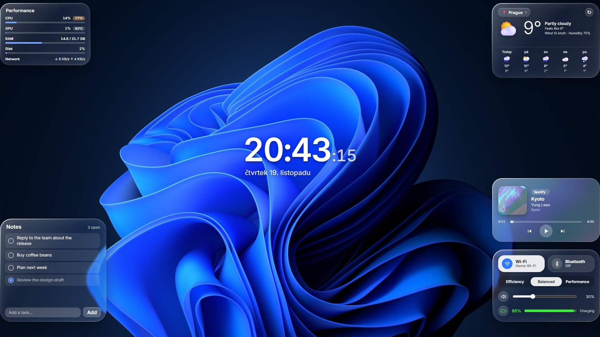

# Widgetopia

Lightweight, transparent desktop widgets for Windows, built with [Tauri 2](https://tauri.app).



One transparent, click-through overlay covers your screen and lives *on* the desktop, below all your windows.
The widgets are plain HTML/CSS/JS inside it, so everything runs in a single small WebView2 process instead of
one window per widget. Clicks on empty areas go straight through to your desktop and icons.

## Quick start

Requirements: Windows 10/11 (WebView2 is preinstalled on Windows 11), [Node.js](https://nodejs.org) 18+,
[Rust](https://rustup.rs) (stable, MSVC toolchain) and the Visual Studio C++ build tools.

```sh
npm install
npm run dev          # run it
npm run build        # build an installer (MSI / NSIS)
```

There is no window and no taskbar button. Widgetopia shows up as widgets on the desktop and as a **tray icon**
next to the clock. To quit: right-click a widget → **Settings** → **Quit**.

## How to use it

Widgets start **unlocked**, so you can arrange them right away.

| Do this | To get this |
|---|---|
| Press and drag anywhere on a card (not on a button) | Move the widget |
| Drag the grip in the bottom-right corner of a card (shown when you hover it) | Resize it; double-click the grip to reset the size |
| **Right-click** a widget | Quick menu of that panel's own options, plus *Settings*, *Reload* and *Lock / Unlock widgets* |
| **Lock widgets** (right-click menu, or Settings) | Widgets can no longer be moved, but stay clickable. Resizing while locked can be allowed in Settings → Layout |
| Tray icon → right-click | *Reload* and *Settings* |
| `Ctrl + Alt + W` (optional, off by default) | Hide / show all widgets at once (Settings → Layout) |

Positions, sizes and all options are remembered between runs.

### Settings

Right-click any widget → **Settings** (or tray icon → Settings). It has these sections:

- **Panels**: a switch for every panel; expand a panel (the small arrow) for its own options.
- **Appearance**: visual style (Liquid glass, Solid, Paper, Neon, Terminal, Minimal), colours, glass tint and font.
- **Layout**: grid overlay, snap to grid / screen edges and centre / other panels (with alignment guides), resizing, global shortcut.
- **Profiles**: save which panels are on, where they are and how big, and switch between such sets in one click.
- **General**: start with Windows, and which monitor the widgets live on (or one checkbox for **all monitors**; you can then drag widgets between them).
- **Glass**: blur and refraction strength, plus two optional, heavier effects (see Performance).

Options that do not apply right now (for example the analog dial while the clock is digital) are greyed out.

## Panels

On a fresh install these are on: **Clock, Weather, Media, Quick settings, Performance, Notes**. The rest are off
and can be switched on in Settings → Panels.

| Panel | What it does |
|---|---|
| **Clock** | Digital or analog (tick marks, numbers or bare dial), optional seconds, 12/24 h and date |
| **Weather** | Current conditions and a 5-day forecast from [Open-Meteo](https://open-meteo.com) (no API key); search any city, °C/°F, forecast can be hidden |
| **Media** | What is playing in Spotify, browsers and any app that uses Windows media controls: cover art, progress with seeking, play / pause / next / previous, source priority, optional time-synced lyrics from [LRCLIB](https://lrclib.net) |
| **Quick settings** | Wi-Fi, Bluetooth, airplane mode, power mode, volume, microphone mute, brightness, dark mode, battery, lock; every tile is optional |
| **Performance** | CPU, GPU, RAM, disk activity and network speed with the temperatures Windows exposes (ACPI thermal zone, NVIDIA GPU sensor) |
| **Notes** | A to-do list or one free-text note, stored locally |
| **Timer** | Pomodoro, countdown and stopwatch with notification and sound |
| **Clipboard history** | Last copied texts, click to copy again. Recording is off until you turn it on, history stays in memory only and password-manager copies are ignored |
| **Calendar** | Events from the local classic Outlook (read while it is running, several calendars selectable) and any number of ICS / webcal links; countdown, join links, optional reminders as Windows notifications |
| **Quick launch** | Drop apps, files, folders or links onto it (or type a path / link, with optional arguments); one click opens them like Explorer would |
| **Agents** | State (working / idle / done) of the agent panes in [herdr](https://herdr.dev); click one to open it |
| **Claude usage** | Token statistics and subscription limits for Claude Code users (see below); off by default |

## Defaults

A fresh install shows the layout from the screenshot: clock in the middle, weather, media and quick settings on
the right, performance and notes on the left, liquid glass style, Midnight colours, Prague as the weather
location, single monitor, global shortcut off, clipboard recording off, lyrics off. Positions are made for a
1920×1080 screen and are clamped on smaller ones.

## Privacy

Everything is stored locally. The only things that leave your PC are: the weather request (city coordinates to
Open-Meteo), the optional lyrics lookup (artist and title to LRCLIB, off by default) and the ICS links you add.

## Performance

Measured on a release build with the default panels and nothing moving: about 3 % of one CPU core and ~550 MB RAM,
most of it WebView2. Rules of thumb used in the code: no endless CSS animations, no large text-shadow blur radii on
text that changes, progress bars use `transform`, and the UI is not rebuilt when data did not change.

Two glass options need a live screen capture and are therefore **heavy** (roughly 15–20 % of a core while active),
so they are opt-in: *Bring to front on click* and *Glass sees desktop icons*. Only the liquid glass style needs them;
the other styles are cheaper.

## Claude usage panel

Token statistics are read from Claude Code's transcripts in `~/.claude/projects`. Claude Code does not store the
subscription limits; its status line receives them. To show them, add this line to your status line script right
after the JSON input is parsed (`$o`):

```powershell
try { if ($o.rate_limits) { [pscustomobject]@{ updated = [DateTimeOffset]::UtcNow.ToUnixTimeSeconds(); rate_limits = $o.rate_limits } | ConvertTo-Json -Depth 6 -Compress | Set-Content -Path (Join-Path $env:USERPROFILE ".claude\widgetopia-usage.json") -Encoding utf8 } } catch {}
```

## How it works

| Piece | Where |
|---|---|
| Overlay window, tray, click-through hit-testing, wallpaper access, screen capture | `src-tauri/src/lib.rs` |
| Window flags (transparent, no decorations) | `src-tauri/tauri.conf.json` |
| Core: dragging, lock, menu, settings, styles, profiles, glass effect | `src/app.js`, `src/style.css` |
| Panels | `src/panels/` |
| Media sessions (Windows media controls) | `src-tauri/src/media.rs` |
| Wi-Fi, Bluetooth, power mode, audio, … | `src-tauri/src/system.rs` |
| CPU / GPU / RAM / disk / network, temperatures | `src-tauri/src/perf.rs` |
| Quick launch (open items, shell icons) | `src-tauri/src/launcher.rs` |
| Calendar (Outlook COM, ICS download) | `src-tauri/src/calendar.rs`, `src/panels/ics.js` |
| Notifications, clipboard, autostart, monitors | `src-tauri/src/extras.rs` |
| herdr agents | `src-tauri/src/herdr.rs` |
| Claude usage statistics | `src-tauri/src/claude.rs` |

### Why the glass looks the way it does

A transparent window cannot blur or refract what is *behind* it (the desktop), because `backdrop-filter` only sees
content inside the webview. Widgetopia therefore reads the current wallpaper, aligns a copy of it with the screen
behind each glass widget, and blurs / refracts that copy with an SVG displacement filter. Desktop icons and other
windows are not part of the effect unless you turn on one of the heavier options above.

## Adding a panel

Add a `<section class="widget" data-id data-title data-toggle>` to `src/index.html`, then a script in
`src/panels/` that calls `registerPanel(id, { options, actions, onOption, onToggle, init })`. Options appear
automatically in the right-click menu and in Settings; an option can have `when: () => boolean` to be greyed out
when it does not apply.

## Tests

The ICS reader has unit tests: `npm test`.

The debug and release builds share one WebView2 profile. To try things without touching your own layout, build a
copy with its own identifier and target folder (in `src-tauri`):
`$env:TAURI_CONFIG='{"identifier":"dev.widgetopia.test"}'; $env:CARGO_TARGET_DIR="target-test"; cargo build`.

## Known limitations

- The media panel shows cover art only: Windows exposes no video frames (Spotify canvas, browser video) to other apps.
- The overlay covers one monitor, or all of them as one wide overlay. In that mode the main wallpaper is repeated for every monitor in the glass.
- In background mode the glass backdrop is the wallpaper only; windows can only be refracted in front mode, where the overlay is hidden from screenshots and screen recordings.
- Outlook is read through its classic desktop app; the new Outlook is not supported.
- CPU temperature is the ACPI thermal zone, not per-core sensors (those need a kernel driver).

## Third-party

- [Inter](https://rsms.me/inter/) font, SIL Open Font License (see `src/fonts/OFL.txt`)
